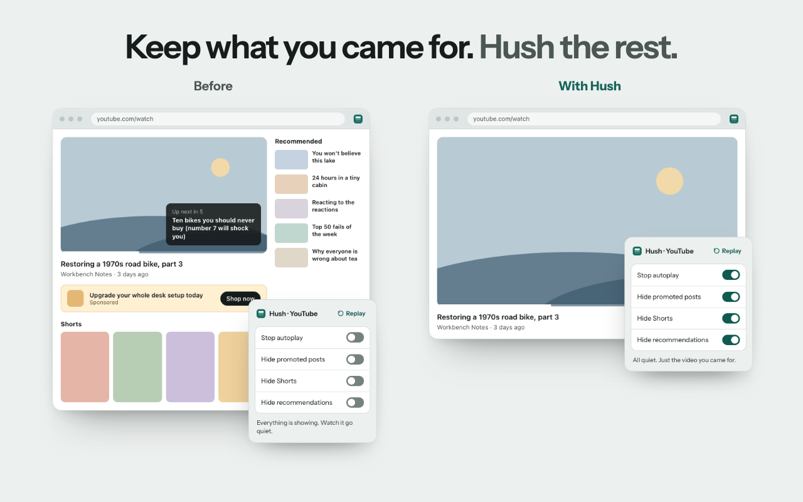
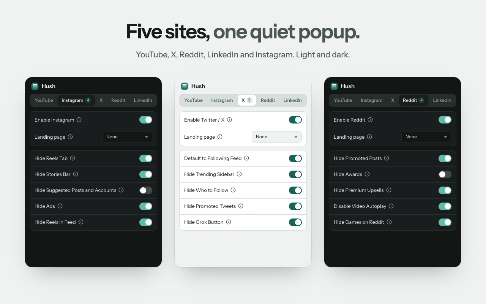

<p align="center">
  
</p>

<h1 align="center">Hush</h1>

<p align="center">
  <strong>Keep what you came for. Hush the rest.</strong><br>
  A free browser extension that hides Shorts, Reels, ads and suggestions on YouTube, X, Reddit, LinkedIn and Instagram.
</p>

<p align="center">
  <a href="https://chromewebstore.google.com/detail/hush-quiet-your-social-fe/geghioemfiedfkmganbkgapajhphecfo"></a>
  <a href="https://chromewebstore.google.com/detail/hush-quiet-your-social-fe/geghioemfiedfkmganbkgapajhphecfo"></a>
  <a href="https://addons.mozilla.org/firefox/addon/hush-quiet-your-social-feeds/"></a>
  <a href="https://addons.mozilla.org/firefox/addon/hush-quiet-your-social-feeds/"></a>
  <br>
  <a href="https://github.com/0xShady/hush/stargazers"></a>
  <a href="https://github.com/0xShady/hush/actions/workflows/check.yml"></a>
  <a href="LICENSE"></a>
</p>

<p align="center">
  <a href="https://chromewebstore.google.com/detail/hush-quiet-your-social-fe/geghioemfiedfkmganbkgapajhphecfo">Add to Chrome</a> ·
  <a href="https://addons.mozilla.org/firefox/addon/hush-quiet-your-social-feeds/">Add to Firefox</a> ·
  <a href="https://hush-media.dev">Website</a> ·
  <a href="https://hush-media.dev/docs">Docs</a>
</p>



## What it hides

Open the popup, pick a site, flip a switch: that part of the page disappears right away, without a
reload. Turn the switch off and it comes back.

| Site | Switches |
|---|---|
| YouTube | Shorts, home feed, sidebar recommendations, end screen, autoplay, Games, Subscriptions list. Also comments beside the video and an optional dislike count |
| X | Promoted posts, Trending, Who to follow, Grok. Also opens on your Following feed |
| Reddit | Promoted posts, awards, Premium upsells, video autoplay, Games |
| LinkedIn | Promoted posts, People you may know, Today's puzzles, Premium upsells |
| Instagram | Reels, Stories, suggested posts and accounts, ads |

You can also choose the page each site opens on, and turn Hush off for a whole site.



No account, no analytics, no ads, no server. Your switches stay in your browser's extension storage.

Hush is an independent project, not affiliated with YouTube, X, Reddit, LinkedIn or Instagram.

## Install (dev)

```bash
npm install
npm run build          # → dist/chrome + dist/firefox (both Manifest V3)
```

- **Chrome**: `chrome://extensions` → enable Developer mode → Load unpacked → `dist/chrome`
- **Firefox**: `about:debugging` → This Firefox → Load Temporary Add-on → `dist/firefox/manifest.json`

## Scripts

| Script | Action |
|---|---|
| `npm run build` | Build both Chrome + Firefox into `dist/` |
| `npm run build:chrome` / `build:firefox` | Single target |
| `npm run lint` | ESLint on the source |
| `npm test` | Build a test copy and run the Playwright tests against the saved pages in `tests/fixtures/` |
| `npm run typecheck` | `tsc --noEmit` |
| `npm run package` | Build then zip both via `web-ext` → `web-ext-artifacts/{chrome,firefox}/hush-<browser>-<version>.zip` |
| `npm run lint:firefox` | `web-ext lint` on the Firefox build (what addons.mozilla.org runs) |
| `npm run dev:chrome` | Watch build with an auto-reloading dev worker and a settings bridge for end-to-end tests (dev only) |
| `npm run start:chrome` / `start:firefox` | Run the build in a separate browser profile with `web-ext`. For a Chromium browser other than Chrome, set `WEB_EXT_CHROMIUM_BINARY` to its path |
| `npm run bump 1.2.3` | Set the version everywhere and add its `CHANGELOG.md` section |
| `npm run release` | Create the GitHub Release for the version in `package.json` (from an up-to-date `main`) |

## Building from source (for add-on reviewers)

Requirements: Node.js 22 and npm 10, on macOS or Linux.

```bash
npm ci
npm run build:firefox   # output: dist/firefox (same files as the submitted package)
```

The source archive attached to each release is `git archive` of the tagged commit.

## Permissions and data

- `storage`: remembers the switches (`storage.sync`).
- `activeTab`: lets the popup see which site the current tab is on.
- Content scripts only on youtube.com, instagram.com, twitter.com, x.com, reddit.com and linkedin.com.
- The only outside request is the optional YouTube dislike count: when the user turns it on, the
  video ID is sent to `returnyoutubedislikeapi.com`. It is off by default. Firefox asks for
  "browsing activity" consent (`data_collection_permissions.optional`) before it can be turned on.

## Releasing

`npm run bump 1.2.3` sets the version in `package.json`, `package-lock.json` and both manifests
(CI rejects a tag that does not match them) and adds a section to `CHANGELOG.md`. Fill it in and
merge that as a PR. Then, on a clean, up-to-date `main`, `npm run release` creates GitHub Release
`vX.Y.Z` with that section as its notes, and the `Release` workflow:

1. builds and lints both targets, and attaches the two zips plus the source archive to the release;
2. uploads the Chrome zip and submits it for review (Chrome Web Store API v2), when the repo
   variable `CWS_EXTENSION_ID` is set;
3. submits the Firefox build with its source to addons.mozilla.org (listed channel), when the repo
   variable `AMO_PUBLISH` is `true`.

`npm run release -- rc.1` makes a pre-release: zips attached, nothing sent to the stores.
The very first version of each listing is uploaded by hand from the release assets.

Secrets: `CWS_SERVICE_ACCOUNT_KEY` (the JSON key of the service account linked to the publisher),
`AMO_JWT_ISSUER`, `AMO_JWT_SECRET`. Variables: `CWS_PUBLISHER_ID`, `CWS_EXTENSION_ID`, `AMO_PUBLISH`.

## Architecture

| Path | Role |
|---|---|
| `src/shared/types.ts` | `Settings` data model + `PLATFORM_KEYS` |
| `src/shared/defaults.ts` | `DEFAULT_SETTINGS` |
| `src/shared/storage.ts` | Typed `getSettings` / `setSettings` / `setPlatformSettings` / `onSettingsChange` over `storage.sync` (merges stored over defaults) |
| `src/shared/platformConfig.ts` | UI metadata: names, feature labels, landing options |
| `src/shared/selectors/*.selectors.ts` | **All CSS selectors live here**, one file per platform |
| `src/content/runtime.ts` | Shared plumbing: CSS injection, MutationObserver, redirect, `onSettingsChange` wiring |
| `src/content/<platform>.ts` | Per-platform feature logic (`buildCss` / `applyDom` / `redirect`) |
| `src/popup/` | Vanilla-TS popup: tabs, master toggle, landing dropdown, feature toggles |

### How a content script works

`runContentScript({ platform, buildCss, applyDom?, redirect? })`:

1. **redirect**: runs on URL change; returns a path to navigate to, or `null`.
2. **buildCss**: returns a CSS string (via `hideRule(selector, on)`) injected into one
   `<style>` tag. CSS auto-applies to future DOM nodes, so most hiding needs no observer.
3. **applyDom**: imperative per-pass work (move comments, pause autoplay, click a tab)
   re-run on every mutation.

Disabling a platform clears its injected CSS. Toggling in the popup fires
`storage.onChanged` → all tabs re-apply **without reload**.

## Selector maintenance

When a platform ships a DOM change and a feature stops working:

1. Open the matching file in `src/shared/selectors/`.
2. Inspect the live page, find the new stable handle (prefer `href`, `role`,
   `data-testid`, `aria-label`, or web-component tag over rotating class names).
3. Update only the selector string. Logic in `src/content/` should not need edits.
4. `npm run build` and reload the extension.

Text-based markers (e.g. "Sponsored", "People you may know") live as exported arrays
at the bottom of the relevant selector file; add localized strings there.

## Icons

- Brand source: `src/assets/icons/icon.svg` (the Hush mark, from the brand kit) and `src/assets/icons/icon-small.svg` (the pixel-tuned 16 px version).
- Shipped PNGs live in `public/icons/` (`icon-16/32/48/128.png`). 16 and 32 come from the brand kit's hand-tuned favicon frames. 128 keeps the art in 96 x 96 with 16 px of transparent padding, as the Chrome Web Store asks.
- Regenerate 48 and 128 after editing the SVG:

  ```bash
  cd src/assets/icons
  magick -background none -density 384 icon.svg -resize 48x48 ../../../public/icons/icon-48.png
  magick -background none -density 384 icon.svg -resize 96x96 -gravity center -extent 128x128 ../../../public/icons/icon-128.png
  ```

- The popup uses Instrument Sans, bundled from `src/popup/fonts/` (SIL Open Font License, shipped as `licenses/InstrumentSans-OFL.txt`).

## Contributing

Issues and pull requests are welcome: see [CONTRIBUTING.md](CONTRIBUTING.md). To report a security
issue, see [SECURITY.md](SECURITY.md).

## License

The code is under the [MIT License](LICENSE). Instrument Sans is under the
[SIL Open Font License](public/licenses/InstrumentSans-OFL.txt).

The MIT License covers the code, not the Hush name or logo (`src/assets/icons/`, `public/icons/` and
the images in `docs/store/`). You are welcome to fork Hush, but if you publish a fork, give it its own
name and icon so nobody mistakes it for Hush.
